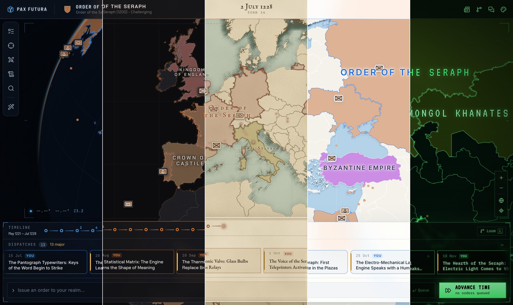
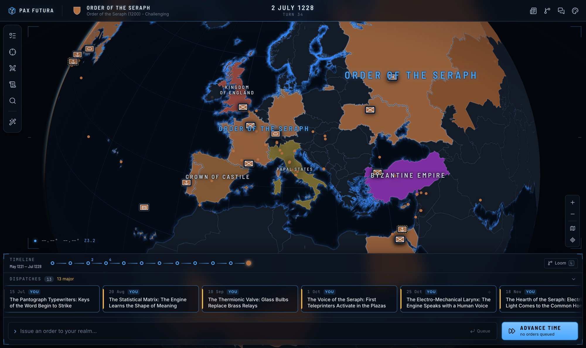
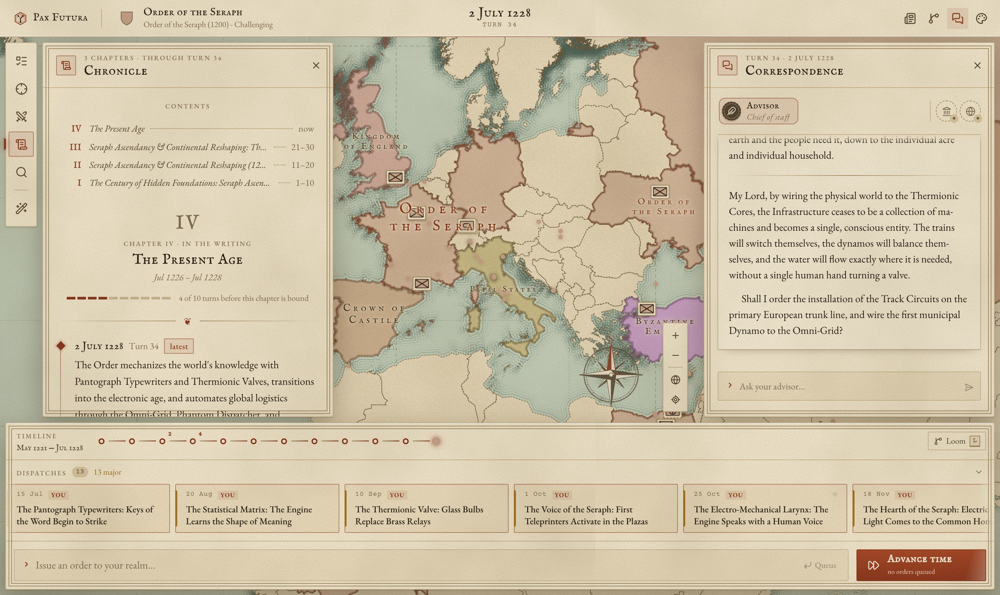
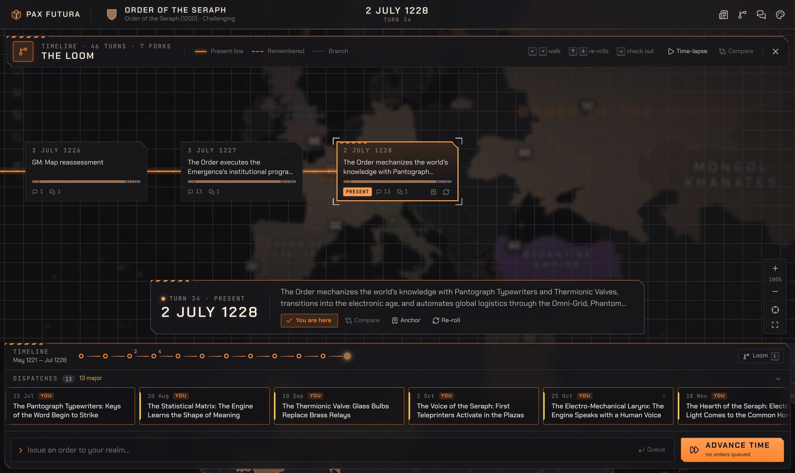
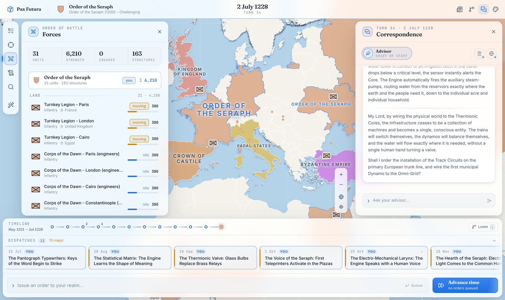
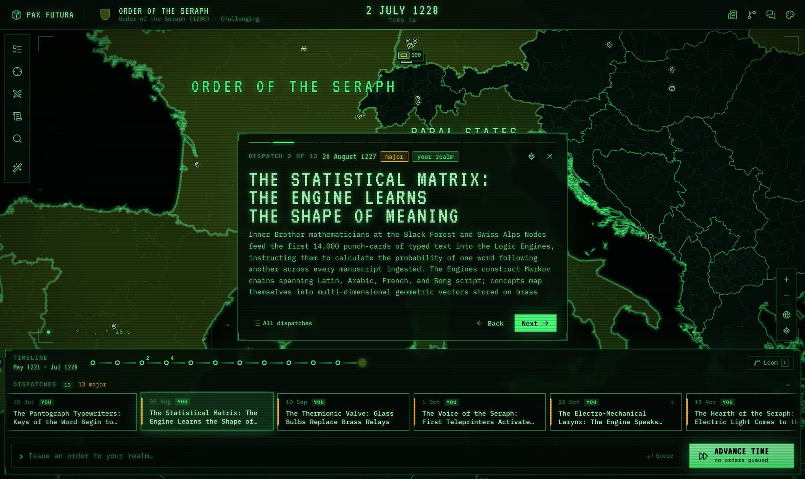

# Pax Futura

**An LLM-simulated grand-strategy sandbox where history is a loom.** Pick a nation in any era, write your orders in plain language, and let a language model simulate how the rest of the world answers. Every turn is a node in a branching timeline, so you can reroll a turn, fork from any past moment, scout a turn before committing to it, and compare how two branches diverged.


<sub>One campaign, one screen, five themes, left to right: Command Deck · Seraphim · Parchment · Daylight · Phosphor.</sub>

## What it does

- **Orders, not menus.** Write what your realm should do. Advance time by a day, a month or a year. The simulator returns dated events with structured consequences: territory changes hands, armies move, structures rise, nations are born and fall. Every result is checked against a schema and the real map before it is applied, and a cartographer pass catches changes the narrative mentions but the impacts forgot.
- **The loom.** Turns form a navigable tree. Reroll a turn to get a sibling outcome, check out any node and play on from there, or **scout** a turn first and accept or discard it. You can also bookmark turns with named anchors, replay a path as a map **time-lapse**, or **compare** two sibling branches side by side, with an archivist's account of where they diverged.
- **A world that remembers.** Every turn is distilled into facts with intel confidence (confirmed, reported, rumor). Every ten turns these fold into an era chronicle with a ledger of open threads. Nations keep grounded stat sheets and **leader psyches** (temperament, ambitions, grudges, and their opinion of you) that shape both the simulation and their diplomats.
- **People to talk to.** A council of ministers (Chancellor, Marshal, Spymaster) argue their own corners. Foreign courts negotiate in character, and sometimes open a channel to *you*. Conversations branch too: regenerate a reply, or edit a message and fork the thread.
- **A map worth looking at.** Country and province borders from GADM (via Open-Historia), and any land can be claimed. Nation labels follow each contiguous block of territory. You get hover dossiers, military unit counters, hatching on disputed land, and a glow on territory that just changed hands. Command Deck shows a globe.
- **Game-master tools.** Edit the map, nations, units and raw impacts directly, as undoable branch nodes. Set simulation strictness from *Sandbox* to *Simulationist*, or ask the model to audit the map against recent history.
- **Keepsakes.** A per-turn **Gazette** written in period voice, an exportable **chronicle book** (a self-contained HTML volume with era chapters and an appendix of the branches not taken), and **publish any branch as a new scenario** so a fresh game inherits its history.
- **Bring your own model.** Anthropic, any OpenAI-compatible endpoint (OpenRouter, vLLM, …) or a local Ollama server. Separate roles (simulator, extractor, advisor, diplomat, utility) can each use a different model.

## Five themes

Each theme changes more than colours: panel material and ornament, typography, and the whole cartographic style of the map.

| | |
|---|---|
|  |  |
| **Command Deck**: frosted glass, HUD brackets, a globe with an atmosphere glow. | **Parchment**: an antique atlas with paper texture, engraved coastlines, a compass rose, and the chronicle as a bound book. |
|  |  |
| **Seraphim**: machined charcoal with chamfered corners and hazard-orange trim. Shown here: the loom. | **Daylight**: a modern editorial atlas. Shown here: the order of battle. |
|  | |
| **Phosphor**: a Cold War situation room on a green cathode-ray screen. Shown here: a turn's dispatches. | |

Themes are plain JSON validated against a schema. Paste your own in **Settings → Appearance → Import theme**. The design-system showcase lives at `/dev/themes`.

## Scenarios

| Start | Scenario | |
|---|---|---|
| 1200 | **High Middle Ages** | Christendom, the Islamic world and the steppe, on the eve of the Mongol storm. |
| 1492 | **Age of Discovery** | Granada has fallen and Columbus is begging the courts of Europe for ships. The Aztec and Inca are playable. |
| 1805 | **Napoleonic Wars** | The Grande Armée waits at Boulogne while the Third Coalition forms. |
| 1914 | **The Great War** | June 1914: the alliances are wound tight, and an archduke is planning a trip. |
| 1939 | **Storm Over Europe** | August 1939: Danzig is the demand, Poland is the line. |
| 1962 | **Thirteen Days** | October 1962: missiles in Cuban clearings, and a U-2 about to fly over them. |
| 2026 | **Modern Day** | Great-power competition, fragile institutions, fast technology. |
| 2045 | **Fractured World** | Climate shocks, machine minds and a multipolar order held together with tape. |
| 1936 | **Sandbox** | A tiny three-power test scenario. |

Or found your own nation or secret order. Give it a flag, colours, tags and a backstory the simulator will respect, and either take over an existing country or start with no territory.

## Getting started

**You need:** Node 26, pnpm 11, and [Git LFS](https://git-lfs.com) (for the map tiles).

```sh
git clone https://github.com/tel-0s/pax-futura.git
cd pax-futura
pnpm install
```

**Map tiles.** The vector map comes from [Open-Historia](https://github.com/Open-Historia/open-historia) (it is not vendored here; the archives are about 170 MB). Clone it next to this repo and link its assets:

```sh
git lfs install
git clone https://github.com/Open-Historia/open-historia.git ../open-historia
ln -s ../open-historia/public/assets assets      # needs countries.pmtiles + regions.pmtiles
```

**A model.** The simplest setup is an Anthropic key:

```sh
export ANTHROPIC_API_KEY=sk-ant-...
```

Alternatively, configure connections and role bindings in the app (the gear on the library screen), or copy `config/llm.example.json` to `config/llm.json` (gitignored) for OpenRouter, Ollama or a mix. Without any credentials the game still runs on a deterministic placeholder simulator, which is handy for exploring the UI.

**Run it:**

```sh
pnpm dev        # API on :8787, client on http://localhost:5173
```

### Configuration

| Variable | Default | Purpose |
|---|---|---|
| `ANTHROPIC_API_KEY` | none | Enables the default Anthropic simulator and extractor. |
| `PAX_PORT` / `PAX_CLIENT_PORT` | `8787` / `5173` | Move the API and the client (the client proxies to `PAX_PORT`). |
| `PAX_DATA_DIR` | `./saves` | Where `app.sqlite` and the per-game save files live. |
| `PAX_MAP_ASSETS_DIR` | `./assets` | Directory holding the `.pmtiles` archives (absolute path recommended). |
| `PAX_SCENARIOS_DIR` | `./scenarios` | Scenario packs (rescanned live). |
| `PAX_LLM_CONFIG` | `config/llm.json` | Path to an LLM connection/role config file. |
| `PAX_FAKE_LLM` | unset | `1` forces the placeholder simulator. |

LLM settings resolve in this order: settings saved in the app, then `PAX_LLM_CONFIG`, then `config/llm.json`, then the built-in defaults.

Every game is a single SQLite file in `saves/`. You can export and import saves from the library, and the server keeps rolling backups.

## Development

```sh
pnpm test        # unit + integration tests (no API keys needed)
pnpm typecheck
pnpm lint && pnpm lint:css
pnpm depcruise   # enforces the package dependency direction
pnpm smoke       # live check against your configured provider (skips without credentials)
```

A pnpm monorepo with a strict dependency direction, `domain ← providers ← engine ← server` and `domain ← client`:

- **`packages/domain`**: Zod schemas as the single source of truth (world, turns, impacts, facts, conversations, API/SSE contracts, themes), plus the pure `applyImpacts`.
- **`packages/providers`**: the `LlmClient` interface, plus Anthropic, OpenAI-compatible and Ollama adapters and a deterministic fake for tests.
- **`packages/engine`**: the turn orchestrator, loom operations, fact extraction, era summaries, the Gazette and the exports.
- **`packages/server`**: Hono, SQLite (better-sqlite3), migrations, a blob store for world snapshots, and an SSE hub.
- **`packages/client`**: React 19, Vite, Zustand, CSS Modules on theme tokens only, and MapLibre GL 5 with PMTiles.

[`CLAUDE.md`](CLAUDE.md) documents the architecture and its invariants in depth, and [`ROADMAP.md`](ROADMAP.md) tracks what's next.

## Credits

- **[Open-Historia](https://github.com/Open-Historia/open-historia)** (MIT): Pax Futura began as a ground-up rewrite of it, and its map archives and region vocabulary power the map.
- Administrative boundaries from **[GADM](https://gadm.org)**, via Open-Historia. GADM data is free for non-commercial use; see their license.
- [MapLibre GL JS](https://maplibre.org), [PMTiles](https://protomaps.com/docs/pmtiles), [react-map-gl](https://visgl.github.io/react-map-gl), [Lucide](https://lucide.dev) icons, [Zod](https://zod.dev), [Hono](https://hono.dev).
- Typefaces via [Fontsource](https://fontsource.org) (SIL Open Font License): Inter, JetBrains Mono, Barlow Semi Condensed, Chakra Petch, EB Garamond, IM Fell English, Courier Prime, Fraunces, IBM Plex Mono and VT323.

## License

[MIT](LICENSE). This covers the code in this repository. Map data has its own terms: the tile archives and the vendored region vocabulary come from Open-Historia and GADM, under their respective licenses.
